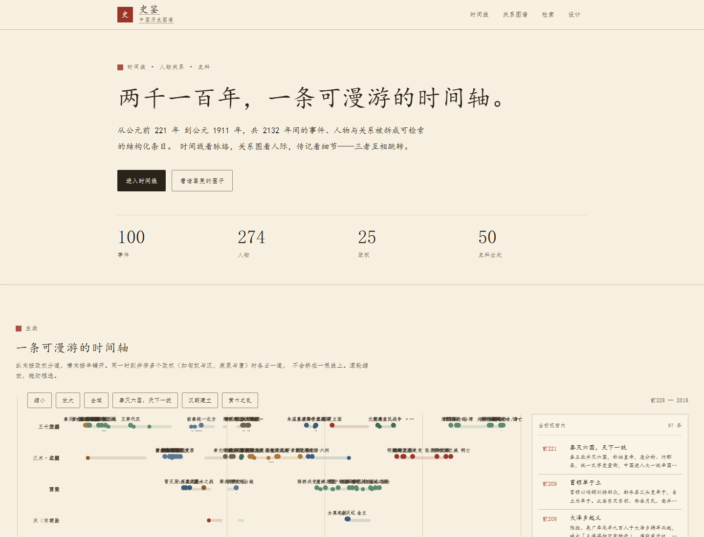
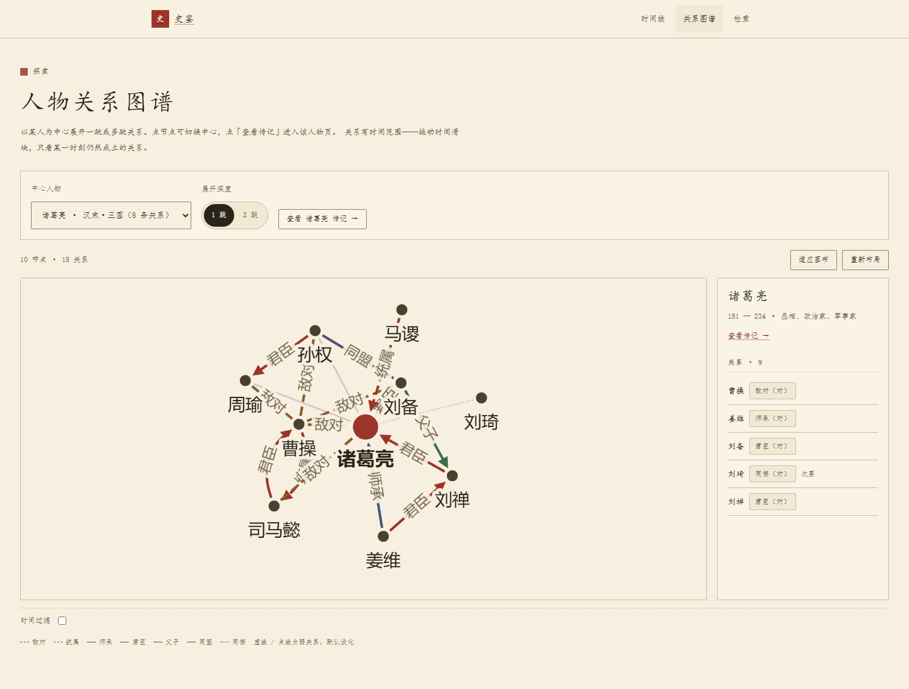
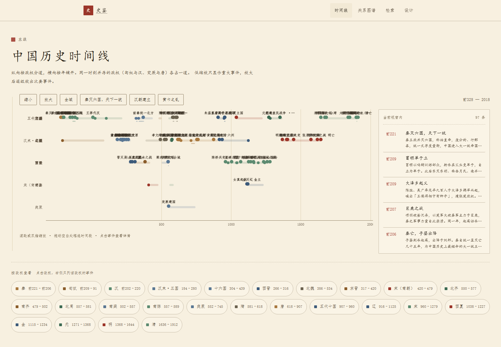
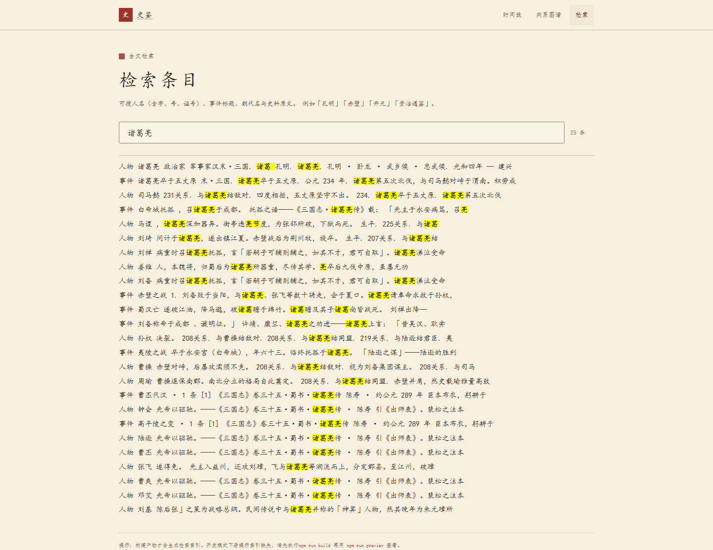
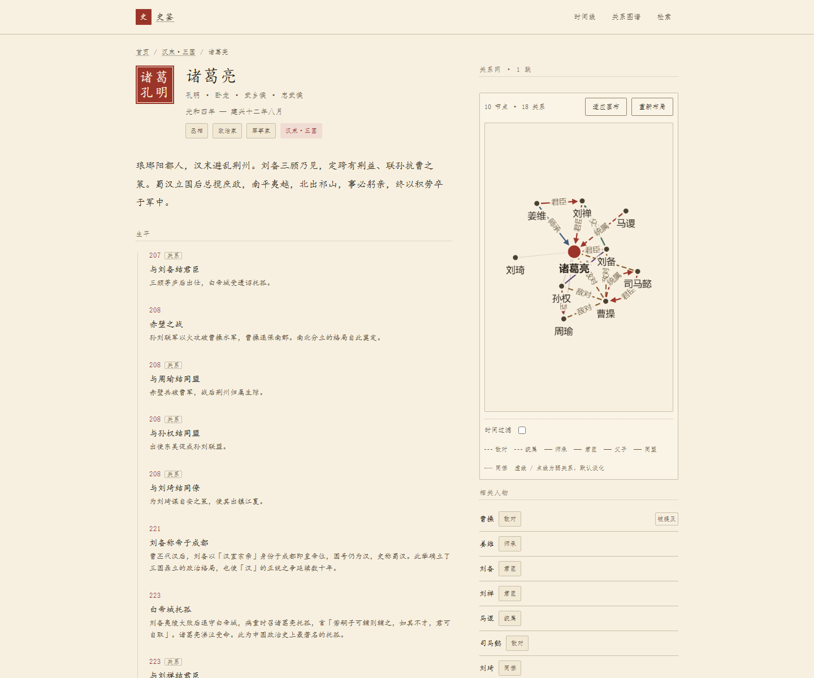
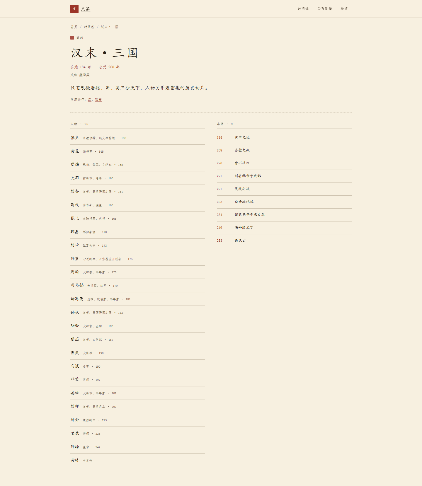

# 史窗

两千一百年，一条可漫游的时间轴。从公元前 221 年到 1911 年，把事件、人物、政权与史料串在一张可交互的图谱上。



## 这是什么

一个中国历史的可视化百科，构建产物是纯静态站点 —— 没有后端、没有数据库，所有内容以 Markdown / YAML 写在仓库里，构建时生成 HTML。

规模：

| 类型 | 数量 |
| --- | --- |
| 事件 | 142 |
| 人物 | 321 |
| 政权 | 28 |
| 史料引用 | 459 |

技术栈是 Astro + Vue：Astro 负责内容渲染与静态生成，Vue 只在需要交互的地方接管（时间轴、关系图谱、检索）。

## 亮点

### 人物关系图谱

用 Cytoscape 画关系网络，以某个人为中心展开一到两层。关系按类型着色 —— 君臣、敌对、师承、同盟、父子、同僚，一眼能看出谁和谁是什么关系，点节点可跳到传记。



### 可漫游的时间轴

横向时间轴按「大事 / 人物 / 战争 / 文艺 / 科技」分轨，缩放到任意年代。配合右侧的「最新发现」侧栏，从任意一个点都能横向漫游到相邻的事件。



### 跨条目检索

全文检索走 Pagefind，构建时生成索引，运行时不请求任何外部服务。



### 内容与呈现分离

内容全是 Markdown / YAML，字段规范写在 [docs/CONTENT-SCHEMA.md](docs/CONTENT-SCHEMA.md)。新增一条事件不需要碰任何组件代码，写对字段构建就出页面。

## 页面形态

<table>
<tr>
<td width="50%"><br /><sub>人物传记：生平、关系、相关事件</sub></td>
<td width="50%"><br /><sub>政权页：疆域、世系、同期事件</sub></td>
</tr>
</table>

## 快速开始

不需要下载字体，整站使用系统字体栈，构建不依赖网络。

```bash
npm ci
npm run dev      # http://localhost:4321
```

构建与校验：

```bash
npm run validate   # 引用完整性检查（外键悬空、id 拼错）
npm run check      # astro check，TS 类型
npm run build      # 完整构建 + Pagefind 索引
```

## 性能

首屏零字体请求（整站走系统字体，此前 webfont 占首屏传输 87%），Lighthouse 移动端 Performance 从 71 提升到 100。

## 文档

- [docs/CONTENT-SCHEMA.md](docs/CONTENT-SCHEMA.md) —— 内容字段规范，新增内容前必读
- [docs/STYLE-GUIDE.md](docs/STYLE-GUIDE.md) —— 样式规则与设计令牌
- [docs/PENDING-FEATURES.md](docs/PENDING-FEATURES.md) —— 已知未完成项与风险
- [CONTRIBUTING.md](CONTRIBUTING.md) —— 开发环境、提交约定

## 目录

```
src/
├── content/          # 内容源：events / people / polities / sources
├── pages/            # Astro 路由页面
├── components/       # Vue 交互组件（时间轴、关系图、检索）
├── lib/              # 关系模型、时间处理、markdown 插件
└── styles/           # 设计令牌与全局样式

scripts/              # 内容校验、令牌生成、截图等构建/维护脚本
docs/                 # 内容规范、样式指南、README 截图
```

## 提交约定

提交信息用中文，前缀 `feat:` / `fix:` / `docs:` / `content:` / `perf:` / `test:`。
**不加 AI 作者署名** —— 由 husky 的 `commit-msg` 钩子自动剥离，详见 [CONTRIBUTING.md](CONTRIBUTING.md)。
